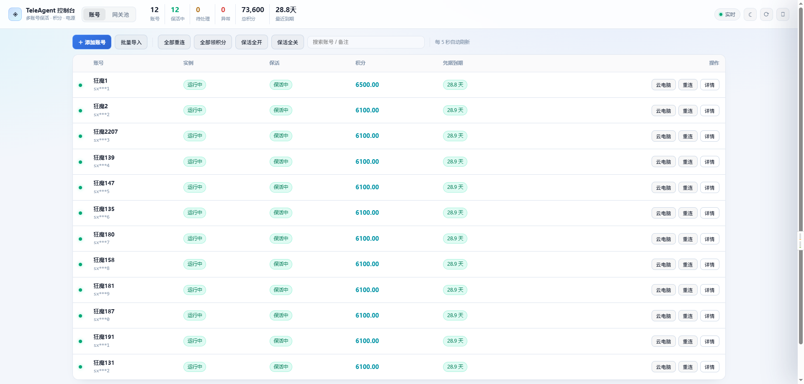
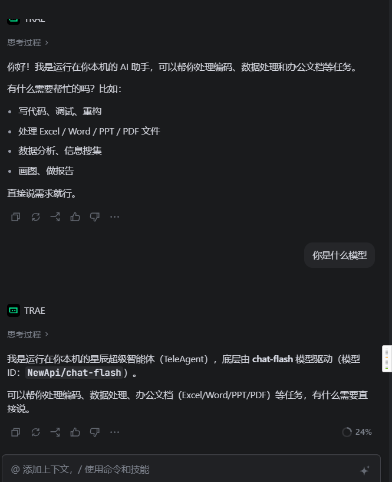
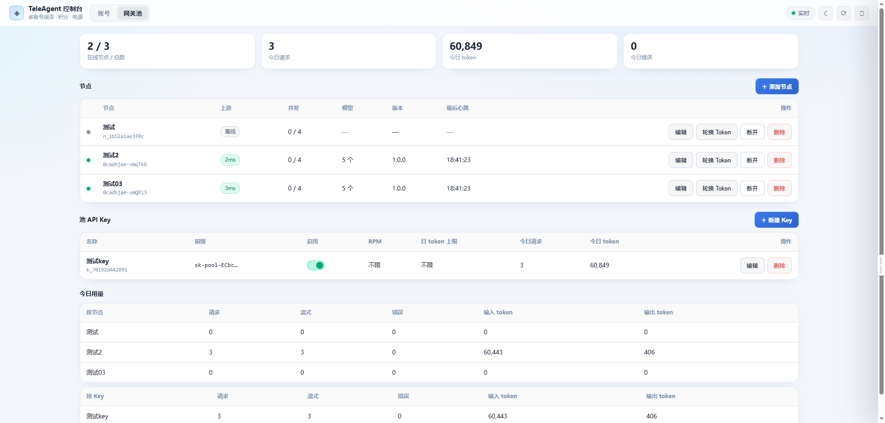

# TeleAgent 分布式 API 池

把 **TeleAgent 云电脑账号** 变成一套可管理的算力池：服务器统一保活多账号、统一暴露 OpenAI 兼容接口，多台 Windows 机器作为节点通过出站 WebSocket 接入，无需公网 IP，NAT 后也能用。

[](https://github.com/shixiangkuangmo/teleagent)
[](https://github.com/shixiangkuangmo/teleagent/fork)


> 个人自用项目，用于管理自己的账号与配额。请遵守 TeleAgent 服务条款，不要用于转售或对外提供公共服务。

> ⭐ **如果这个项目对你有帮助，点个 Star 支持一下**，这是我持续维护和更新的最大动力。

---

## 一、它由三部分组成

| 模块 | 位置 | 作用 |
|---|---|---|
| **管理面板** | `teleagent-dashboard/` | Node.js 18+，多账号保活 / 积分领取 / 电源管理 / 实例状态；同时是网关池的服务器端，对外提供 `/v1` |
| **本机网关** | `TeleAgent-OpenAI/teleagent_gateway.py` | Python，把 Windows 上 TeleAgent 客户端的 4397 接口包装成 OpenAI 兼容 API（`127.0.0.1:8899/v1`） |
| **节点代理** | `TeleAgent-OpenAI/pool_agent.py` + `node_gui.py` | 主动连接面板的 WebSocket，上报状态、转发聊天请求；可打包成单个 exe，图形化配置 |

三者关系：

```
                 OpenAI SDK / 任意客户端
                          │  /v1/chat/completions（池 Key）
                          ▼
        ┌─────────────────────────────────────┐
        │  teleagent-dashboard（Linux/Docker） │
        │  ├─ 账号面板：保活 / 积分 / 电源      │
        │  ├─ 网关池：节点路由 / 限额 / 用量    │
        │  └─ /v1 OpenAI 兼容入口              │
        └──────────────┬──────────────────────┘
                       │ 出站 WebSocket（节点主动连服务器）
          ┌────────────┼────────────┐
          ▼            ▼            ▼
    Windows 节点A  Windows 节点B  Windows 节点C
    pool_agent     pool_agent     pool_agent
        │              │              │
        ▼              ▼              ▼
    本机网关 8899  本机网关 8899  本机网关 8899
        │              │              │
        ▼              ▼              ▼
   TeleAgent 4397 TeleAgent 4397 TeleAgent 4397
```

**为什么用 WebSocket 反向连接**：Windows 节点通常在家庭宽带 / NAT 后面，服务器无法主动连它。节点启动时主动连服务器，之后上报和转发都复用这条长连接，不需要端口映射，也不需要公网 IP。

---

## 二、核心能力

### 管理面板（多账号）

- 多账号隔离：每个号独立目录、独立 AES-256-GCM 密钥，互不影响
- 启动错峰、批量导入（`账号 密码 [备注]` 一行一个）、逐条回报失败原因
- 保活自愈：掉线自动重登，实例关机/排队自动拉起
- 积分刷新与定时领取，可配企业微信 Webhook 通知
- 电源管理：重启 / 重置 / 取消，桌面实例领取与打开
- 登录凭据加密落盘，JWT 自动重登后重新绑定到 API 与保活模块
- 面板密码保护（明文或用 `sha256("user:密码")` 哈希）



<p align="center"><sub>账号面板：在线状态、实例、保活、积分与免费到期天数一屏掌握</sub></p>

### 本机网关（OpenAI 兼容）

- `GET /v1/models`、`POST /v1/chat/completions`
- **真流式**：订阅上游 `/event` 的 SSE，边生成边转发，不再等整段回复
- 首字节探活 + 3 秒心跳，避免客户端/中间层超时断连
- `tools` / `function calling`、`response_format` 走提示词桥接（非原生，见下方能力边界）
- 系统提示词策略：`replace`（默认）/ `strip` / `filter`，支持自定义提示词文件
- 超长 prompt 自动截断（保留开头系统提示 + 最近对话）
- 可选 `TG_API_KEY` Bearer 鉴权、请求体大小限制、临时会话自动清理
- `/pool/status` 供节点代理采集，`/health` 只读缓存、不阻塞



<p align="center"><sub>通过网关调用本机 TeleAgent 通道的实际回复（chat-flash）</sub></p>

### 网关池（多机分布式）

- 节点出站 WebSocket 接入，支持 `ws://` / `wss://`，NAT 后可用
- 节点 Token、池 API Key 只存 `sha256`，明文只在创建时显示一次
- 路由：最少在途请求优先，`weight` 加权打破平局
- 故障转移：只在 `chat_start`（首字节）到达前重试，最多换 2 个节点
- 非流式整体缓冲、SSE 流式透传；下游慢时对节点 socket 施加背压
- 超时：开始 60s、空闲 90s、总时长 30min；客户端断开立即通知节点取消
- 限额：池 Key 可设 RPM 滑动窗口与每日 token 上限，超限 429
- 用量：按天聚合总量 / 分节点 / 分 Key / 分模型，保留 30 天
- 45 秒无心跳判离线并摘除，离线可复用面板通知渠道
- 面板内置「网关池」视图：节点表、Key 表、用量表，全部可视化操作



<p align="center"><sub>网关池：节点在线/上游延迟、池 Key 限额、按节点与按 Key 的当日用量</sub></p>

---

## 三、目录结构

```
teleagent/
├── teleagent-dashboard/          # 服务器端（Node.js）
│   ├── server.js                 # HTTP 服务、面板路由、/v1 入口
│   ├── lib/
│   │   ├── gatewaypool.js        # 网关池核心：WS 协议、路由、限额、用量
│   │   ├── jsonstore.js          # JSON 原子写 + 防抖落盘
│   │   ├── aes.js                # AES-256-GCM 凭据加密
│   │   ├── accounts.js           # 多账号上下文
│   │   ├── keepalive.js          # 保活与实例自愈
│   │   ├── login.js / auth.js    # 网页登录、JWT
│   │   ├── api.js / scheduler.js # 积分接口与定时领取
│   │   ├── power.js              # 电源管理
│   │   ├── panelauth.js          # 面板登录保护
│   │   ├── notify.js / log.js / sysmon.js
│   │   └── ...
│   ├── public/                   # 面板前端（账号视图 + 网关池视图）
│   ├── Dockerfile
│   ├── docker-compose.yml
│   └── .env.example
├── TeleAgent-OpenAI/             # Windows 节点端（Python）
│   ├── teleagent_client.py       # 提取 sessionKey、签名调用 4397
│   ├── teleagent_gateway.py      # OpenAI 兼容网关
│   ├── pool_agent.py             # 出站 WS 节点代理
│   ├── node_gui.py               # 图形界面（打包 exe 的入口）
│   ├── tg_sanitize.py            # 系统提示词清洗
│   ├── build-exe.bat             # 一键打包 TeleAgentNode.exe
│   └── pool-agent.example.json   # 节点配置模板
└── README.md
```

运行时目录 `data/`、`.env`、`pool-agent.json`、打包产物 `dist/`、内嵌 Python 运行时 `python/` 均已在 `.gitignore` 中排除，**不会进入仓库**。

---

## 四、部署教程

### 第 1 步：服务器（Linux + Docker）

要求：Docker 与 Docker Compose v2，服务器能访问外网。

```bash
# 把 teleagent-dashboard 目录上传到服务器，例如 /opt/teleagent-dashboard
cd /opt/teleagent-dashboard

cp .env.example .env
vi .env          # 必改 TA_PANEL_PASSWORD，否则面板无鉴权

docker compose up -d --build
docker compose ps          # 等状态变成 healthy
docker compose logs -f --tail=50
```

打开 `http://<服务器IP>:8590`，用 `.env` 里的账号密码登录。

要点：

- 数据全部在 `./data`（容器内 `/app/data`），重建容器不丢：账号密文、JWT、节点、池 Key、用量都在这里。
- 升级代码后重新 `docker compose up -d --build` 即可；若怀疑命中了旧缓存，用 `docker compose build --no-cache`。
- 只通过隧道访问时，把端口改成 `"127.0.0.1:8590:8590"`，避免直接暴露。
- 对外提供 `/v1` 前，务必在前面加一层 HTTPS 反代（Caddy / Nginx / Cloudflare Tunnel）：
  - 节点用 `wss://`，反代必须转发 `Upgrade` / `Connection` 头；
  - `/v1` 的流式响应必须关闭缓冲（Nginx `proxy_buffering off`）；
  - 读写超时调大（建议 1800s 以上）。

### 第 2 步：面板里创建节点和池 Key

1. 顶栏切到「网关池」。
2. 「添加节点」：填名称、权重（默认 1）、最大并发（默认 4）。创建成功后会显示一次节点 ID（`n_...`）和节点 Token（`sk-node-...`），**关掉就再也看不到**。
3. 「池 Key」→ 新建：填名称，可选 RPM 与每日 token 上限。同样只显示一次 `sk-pool-...`。

### 第 3 步：Windows 节点

前置条件：

- Windows 10/11；
- TeleAgent 客户端已安装、已登录、正在运行（本机监听 `127.0.0.1:4397`）；
- 无需安装 Python（使用 exe 时）。

方式 A：单文件 exe（推荐）

1. 从 `TeleAgent-OpenAI/dist/TeleAgentNode.exe`（或自行打包）复制到节点机器。
2. 双击运行，填写：

| 字段 | 示例 | 说明 |
|---|---|---|
| 服务器地址 | `wss://panel.example.com/api/pool/agent` | 面板的 WebSocket 地址 |
| 节点 ID | `n_xxxxxxxxxxxx` | 面板创建节点时给的一次性值 |
| 节点 Token | `sk-node-xxxxxxxx` | 同上，只显示一次 |
| 网关地址 | `http://127.0.0.1:8899` | 本地网关，默认即可 |
| 网关 API Key | 空 或 与 `TG_API_KEY` 一致 | 本地网关未开鉴权就留空 |
| 自动启动本地网关 | 勾选 | 由 exe 拉起 `teleagent_gateway.py` 的逻辑 |

3. 点「启动」。日志出现 `已连接 wss://...`、`key 就绪 (x.xs)` 即成功。
4. 面板「网关池」中该节点应显示在线、上游正常。

开机自启：把 exe 的快捷方式放进 `shell:startup`，或注册到「任务计划程序」。

方式 B：源码运行

```bat
set TG_API_KEY=可选
python teleagent_gateway.py --host 127.0.0.1 --port 8899
python pool_agent.py --config pool-agent.json
```

`pool-agent.json` 参考 `TeleAgent-OpenAI/pool-agent.example.json`：

```json
{
  "server": "wss://panel.example.com/api/pool/agent",
  "node_id": "n_xxxxxxxxxxxx",
  "token": "sk-node-xxxxxxxxxxxxxxxxxxxxxxxx",
  "gateway_url": "http://127.0.0.1:8899",
  "gateway_key": "",
  "name": "办公机-01",
  "max_inflight": 4,
  "insecure": false
}
```

也可以用环境变量：`POOL_SERVER`、`POOL_NODE_ID`、`POOL_TOKEN`、`POOL_GATEWAY_URL`、`POOL_GATEWAY_KEY`、`POOL_NAME`、`POOL_MAX_INFLIGHT`、`POOL_INSECURE`。命令行参数优先级最高。

自行打包 exe：

```bat
cd TeleAgent-OpenAI
build-exe.bat
```

### 第 4 步：客户端调用

把 `base_url` 指向面板的 `/v1`，`api_key` 填池 Key：

```python
from openai import OpenAI

client = OpenAI(
    base_url="https://panel.example.com/v1",
    api_key="sk-pool-xxxxxxxx",
)

# 非流式
r = client.chat.completions.create(
    model="chat-lite",
    messages=[{"role": "user", "content": "用三句话说明什么是反向代理"}],
)
print(r.choices[0].message.content)

# 流式
for chunk in client.chat.completions.create(
    model="chat-lite",
    messages=[{"role": "user", "content": "写一个快速排序"}],
    stream=True,
):
    print(chunk.choices[0].delta.content or "", end="")
```

curl：

```bash
curl https://panel.example.com/v1/chat/completions \
  -H "Authorization: Bearer sk-pool-xxxxxxxx" \
  -H "Content-Type: application/json" \
  -d '{
    "model": "chat-lite",
    "messages": [{"role": "user", "content": "你好"}],
    "stream": true
  }'
```

可用模型：`chat-flagship`、`chat-pro`、`chat-flash`、`chat-lite`、`chat-nano`。

---

## 五、API 参考

### 池接口（服务器 `/v1`）

| 方法 | 路径 | 说明 |
|---|---|---|
| GET | `/v1/models` | 合并所有在线节点上报的模型列表 |
| POST | `/v1/chat/completions` | 支持 `stream: true/false` |
| OPTIONS | `/v1/*` | CORS 预检 |

鉴权：`Authorization: Bearer <池 Key>` 或 `x-api-key: <池 Key>`。

错误响应统一为 `{"error":{"message":"...","type":"...","code":"..."}}`：

| HTTP | code | 场景 |
|---|---|---|
| 401 | `invalid_api_key` | 未带 Key / Key 无效或已禁用 |
| 413 | `payload_too_large` | 请求体超过 8 MB |
| 429 | `rate_limited` | 超过 RPM 或每日 token 上限 |
| 502 | `no_healthy_node` | 没有在线且上游正常的节点 |
| 504 | `upstream_timeout` | 上游超时 |

响应头 `x-pool-node` 标明本次由哪个节点处理，便于排查。

### 池管理接口（面板鉴权后）

| 方法 | 路径 |
|---|---|
| GET | `/api/gateway/overview` |
| GET / POST | `/api/gateway/nodes` |
| PATCH / DELETE | `/api/gateway/nodes/:id` |
| POST | `/api/gateway/nodes/:id/disconnect` |
| GET / POST | `/api/gateway/keys` |
| PATCH / DELETE | `/api/gateway/keys/:id` |
| GET | `/api/gateway/usage` |

### 本机网关接口

| 方法 | 路径 | 说明 |
|---|---|---|
| GET | `/v1/models` | 模型列表 |
| POST | `/v1/chat/completions` | OpenAI 格式 |
| GET | `/pool/status` | 节点代理采集用；设置 `TG_API_KEY` 后需鉴权 |
| GET | `/health` | 只读缓存，不阻塞：200 ok / 503 error / 200 probing |

> 能力边界：`tools` / `function calling` 与 `response_format` 是通过提示词桥接实现的，**不是**上游原生支持；复杂工具调用可能不稳定。网关不会假装支持它做不到的事。

---

## 六、配置项

### teleagent-dashboard

| 变量 | 默认 | 说明 |
|---|---|---|
| `PORT` | `8590` | 监听端口 |
| `TA_DATA_DIR` | `./data` | 持久化目录 |
| `TA_PANEL_USER` | `admin` | 面板用户名 |
| `TA_PANEL_PASSWORD` | 空 | 面板密码；为空则不启用鉴权 |
| `TA_PANEL_PASSWORD_HASH` | 空 | `sha256("user:密码")`，优先于明文 |
| `TA_PANEL_HINT` | 空 | 设为 `1` 时登录页显示用户名提示 |
| `TA_OFFLINE` | 空 | 设为 `1` 进入离线模式，不访问平台接口 |

### 本机网关（teleagent_gateway.py）

| 变量 | 默认 | 说明 |
|---|---|---|
| `TG_API_KEY` | 空 | 设置后启用 Bearer 鉴权（建议与节点配置一致） |
| `TG_MAX_BODY` | `8388608` | 请求体上限（字节） |
| `TG_MAX_PROMPT` | `40000` | prompt 字符上限，超出按头尾截断 |
| `TG_SYSTEM` | `replace` | 系统提示词策略：`replace` / `strip` / `filter` |
| `TG_SYSTEM_TEXT` | 内置 | `replace` 模式下使用的系统提示词 |
| `TG_SYSTEM_FILE` | 空 | 从文件读取系统提示词，优先于 `TG_SYSTEM_TEXT` |
| `TG_MIN_KEEP` | `3` | 裁剪时至少保留的最近消息条数 |
| `TG_KEEP_HISTORY` | `0` | 设为 `1` 保留临时会话（默认用完即删） |
| `TG_NODE_NAME` | 空 | 节点显示名，会出现在 `/pool/status` 中 |

### 节点代理（pool_agent.py）

| 参数 | 环境变量 | 默认 |
|---|---|---|
| `--server` | `POOL_SERVER` | 必填，如 `wss://panel.example.com/api/pool/agent` |
| `--node-id` | `POOL_NODE_ID` | 必填 |
| `--token` | `POOL_TOKEN` | 必填 |
| `--gateway-url` | `POOL_GATEWAY_URL` | `http://127.0.0.1:8899` |
| `--gateway-key` | `POOL_GATEWAY_KEY` | 空，回退 `TG_API_KEY` |
| `--name` | `POOL_NAME` | 空 |
| `--max-inflight` | `POOL_MAX_INFLIGHT` | `4` |
| `--insecure` | `POOL_INSECURE` | 关闭 TLS 证书校验（仅调试） |
| `--config` | — | JSON 配置文件路径 |

---

## 七、安全建议

1. **必须用 HTTPS / WSS**。明文 `http://` / `ws://` 会把池 Key、节点 Token、聊天内容暴露在链路上。没有域名时只适合临时内网测试。
2. 面板密码不要与其它网站复用；可用 `TA_PANEL_PASSWORD_HASH` 避免明文落盘。
3. 节点 Token 与池 Key 只存 `sha256`，泄漏后到面板删除并重建即可。
4. `data/` 目录包含账号凭据密文与 JWT，备份时注意权限（建议 `chmod 700`），不要提交到任何仓库。
5. 一个 `node_id` 同时只能运行一个代理，重复启动会互相踢下线。
6. 一个 `TA_DATA_DIR` 只能被一个 dashboard 进程使用，否则并发写会互相覆盖。
7. `--insecure` 只用于自签名证书调试，生产不要开。

---

## 八、故障排查

| 现象 | 原因与处理 |
|---|---|
| 面板节点一直离线 | 检查节点日志是否 `已连接`；确认服务器 8590 可达；确认 Token 没被轮换或删除 |
| 节点反复 401 | 面板里节点被删除/重建/轮换 Token，重新复制新的 ID 和 Token |
| `/v1` 返回 502 `no_healthy_node` | 节点离线，或节点上报的 `upstream.ok` 不是 `true`（本机网关或 TeleAgent 客户端不可用） |
| 节点上游一直 `null` | 旧版本网关在未设 `TG_API_KEY` 时不返回 upstream；升级到 2.3.0 及以上，或在节点配置里填一个网关 API Key |
| 日志停在「提取 sessionKey ...」 | TeleAgent 客户端没启动或没登录；先打开客户端并登录，等出现 `key 就绪` |
| 流式输出一次性到达 | 反代开了缓冲；Nginx 加 `proxy_buffering off`、`proxy_cache off`，并放大超时 |
| 请求超时 504 | 首字节 60s / 空闲 90s 超时；检查上游是否卡住，或调大网关/反代超时 |
| 429 `rate_limited` | 池 Key 的 RPM 或每日 token 限额到了；改 Key 限额或换 Key |
| 413 `payload_too_large` | 请求体超过 8 MB，精简上下文 |
| 面板没有「网关池」标签 | 服务器跑的是旧镜像；`docker compose build --no-cache && docker compose up -d`，浏览器强制刷新 |

---

## 九、更多文档

- 面板与网关池详细说明：[teleagent-dashboard/README.md](teleagent-dashboard/README.md)
- Windows 网关与节点代理说明：[TeleAgent-OpenAI/README.md](TeleAgent-OpenAI/README.md)

---

## 十、Star 趋势

[](https://star-history.com/#shixiangkuangmo/teleagent&Date)

如果这个项目帮你省了时间，欢迎 **Star**、Fork、提 Issue。你的每一个 Star 都会被看到。

---

## 十一、免责声明

本项目仅用于学习与个人账号管理，不提供任何形式的服务担保。使用者需自行确保：

- 仅操作自己拥有或获授权的账号；
- 遵守 TeleAgent / TeleAI 的服务条款与当地法律法规；
- 不将本工具用于商业转售、批量注册、绕过风控或对外提供公共服务。

因使用本项目产生的账号封禁、数据丢失或其它后果，由使用者自行承担。
